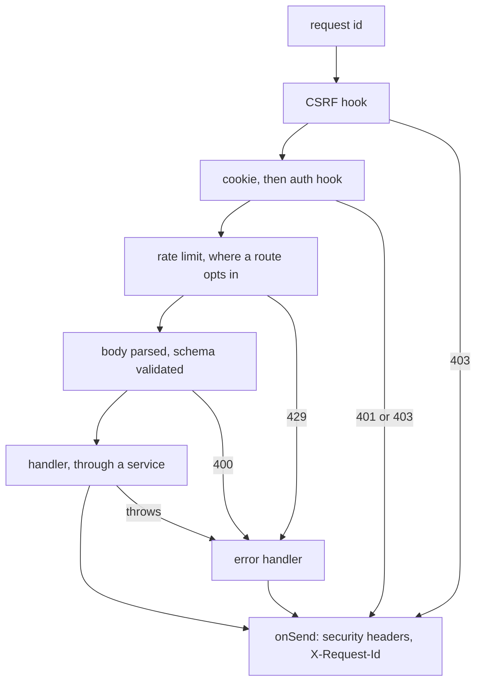

# HTTP

How a request passes through the server, and the answers that leave the usual path.
`src/server.ts` registers the hooks, and the order it registers them in is the order they run in.
What routes share is in `src/http/`: `security.ts` (request id, CSRF, headers), `auth.ts`, `errors.ts`, `etag.ts`, `sendBlob.ts` and `static.ts` (the PWA and the not-found handler).

## One request

- A well-formed incoming `X-Request-Id` is kept, so a proxy's id follows the request into the logs; otherwise the id is a new UUID.
- CSRF runs first: an unsafe method whose `Sec-Fetch-Site` is present and neither `same-origin` nor `none` gets `403` before the cookie is read.
  No header at all, as from curl or an old browser, passes; the cookie's `SameSite=Lax` is the other half of the defence.
- The auth hook must follow `@fastify/cookie`, whose own hook parses the cookie; it reads the route's `config.auth` and is the only code that reads the cookie.
- Rate limits are hooks on the route, which Fastify runs after the shared ones, so a refused cross-site request is never counted.
- The not-found handler passes the same hooks: an unknown `GET` outside `/api` gets the PWA's `index.html`, anything else a `404`.

## Answers that leave the path

- The Live Update stream hijacks its reply, so neither `onSend` nor the error handler reaches it.
  It writes `securityHeaders()` itself and ends the stream when it fails; a header added in `onSend` must be added there too.
- A hook that answers early never reads the body; Node reads and discards it afterwards, so the connection is reused.
  The hooks run before the upload checks `BLOB_LIMIT_BYTES`; an early answer to a body over `BODY_LIMIT_BYTES` closes the connection instead of reading it (`sendEarlyProblem`).
- The upload's plugin swaps the body parsers for the raw stream, so the route answers before reading a byte where it can.
  `411` without `Content-Length` and `413` over the limit send `Connection: close`, since reading that body is wasted; `400`, `404` and the repeat's `204` drain it.
- `BODY_LIMIT_BYTES` bounds the JSON parser only; an upload is bounded by its own `Content-Length` check.

## ETags

- A feed page's ETag is the SHA-256 of its JSON body, with `Cache-Control: private, no-cache`, so a Device revalidates every time and an unchanged page answers `304`.
- A blob's ETag is its id, since bytes are write-once by id; a missing file answers `404` before any caching header is set (see [`blobs.md`](blobs.md)).
- `If-None-Match` is compared weakly, as RFC 9110 asks: a `W/` a proxy added is ignored, and `*` matches.

## Problem details

Every error leaves as RFC 9457 `application/problem+json`: `type` is `about:blank`, `title` the status's name, `detail` what went wrong, and a schema failure adds `errors`, one path per issue.
Services throw the classes in `src/shared/errors.ts`, which the error handler maps to `400`, `401`, `403`, `404`, `409` and `410`; a new class extends one of them, or it leaves as a `500`.
Fastify's and the plugins' own 4xx errors keep their status, such as `413` for a JSON body over the limit and `429` from the rate limit.
Anything else is a `500` without a `detail`, logged with the request id; a client that hangs up mid-body is a `400`, logged at info.
Handlers throw; only the hooks, the not-found handler and the blob routes call `sendProblem` themselves.
