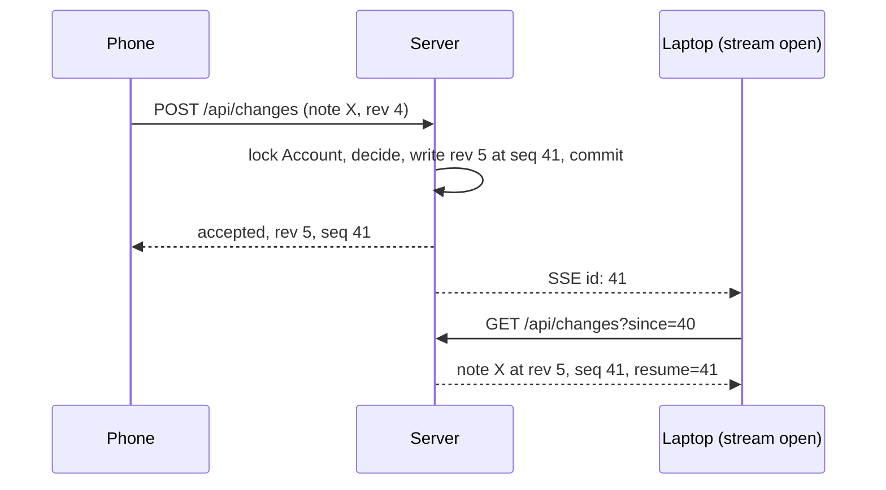

# Sync

How a Device's changes reach the server and the other Devices.
The code is `src/modules/sync/`: `decide.ts` (the rules, pure), `service.ts` (the push and the feed), `routes.ts` (HTTP and the SSE stream), `liveUpdates.ts` (the open streams).
The decision behind the shape is ADR 0002 and the frontend's sync evaluation; the product terms (Revision, Tombstone, Conflicted Copy, Catch-up, Live Update) are in the frontend's `CONTEXT.md`.

## Two counters

- **Revision** (`rev`): per row, assigned by the server on every accepted write; the Device sends back the one it last agreed with.
  It is the row's `ETag` in spirit: a push with a stale `rev` is a conflict, never a silent overwrite.
- **Sequence** (`seq`): per Account, advanced by every accepted write; every synced row carries the Sequence at which it was last accepted.
  The feed is ordered by it, a Device's cursor is one, and a Live Update hint carries one.
  `prunedSeq` is the highest Sequence of a Tombstone the sweep has removed.

## The push

`POST /api/changes` carries one batch: up to `MAX_BATCH` rows across `notes`, `tags`, `noteTags` and `tombstones`.
The service runs the whole batch in one transaction and takes the Account's write lock before its first read, so two pushes to one Account run one after the other and never share a Sequence.
Each row gets one outcome, in input order; every accepted write takes the next Sequence.
After the commit, every other open stream of the Account gets a hint with the new Sequence.

| Device sends | Server has | Outcome |
|---|---|---|
| a row without `rev` | nothing | `accepted`, rev 1 |
| a row without `rev` | the row | `conflict`, with the server's row |
| a row, `rev` equal | the row | `accepted`, rev + 1 |
| a row, `rev` lower or higher | the row | `conflict`, with the server's row |
| any row | a Tombstone for it | `gone` |
| a NoteTag | its Note or Tag missing or tombstoned | `gone` |
| a NoteTag, any `rev` | anything else | `accepted`; a link has nothing to conflict over |
| a Tombstone, `rev` equal | the row | `accepted`: row deleted, Tombstone written |
| a Tombstone, `rev` stale or absent | the Note or Tag | `conflict`, nothing written; the purge would discard a newer edit |
| a Tombstone | a Tombstone already | `accepted`, nothing written; another Device sent it first |
| a NoteTag Tombstone | the link | `accepted` without a `rev` check |

A row without `rev` that the server already has is a conflict because the Device never pushed it, so the server's row is older or someone else's.
A row with a `rev` the server has forgotten (its Tombstone expired) is accepted at rev 1; nothing anyone wrote is lost that way.

On `conflict` the Device installs the server's row and keeps its own text as a Conflicted Copy, a new Note; on `gone` it drops the row.
Both happen on the Device; the server only reports.

## Tombstones

A Tombstone says a Note, Tag or link was purged, so the deletion reaches Devices that were offline.
Trashing is an ordinary edit of `state` and writes none.
Three rules keep the table small and the feed honest:

- Purging a Note or Tag removes its links but writes no NoteTag Tombstones; Devices drop the links of a purged row themselves.
- Re-linking a Note and Tag removes the link's old Tombstone, so the feed never says both.
- The daily sweep (`modules/housekeeping`) removes Tombstones older than `TOMBSTONE_DAYS` (90) and raises the Account's `prunedSeq` to the highest one removed.

## The feed

`GET /api/changes?since=<seq>` returns the rows of the Account written after `since`: up to a page from each of the four kinds, merged by Sequence and cut to `PAGE_SIZE` (50).
The page is read under the Account's read lock, so a push landing meanwhile can neither split it nor put a row past the `seq` it reports.
A full page carries a `next` link (`since` = the page's last Sequence, `from` = where the pull began); the Device follows `next` until it is absent, then keeps `resume` as the cursor for the next Catch-up.
The body is served with an `ETag`, so an unchanged feed answers `304`.

A cursor is refused with `410 Gone`, and the Device resyncs from 0, when:

- `from` (or `since` on the first page) is above 0 and below `prunedSeq`: a Tombstone it never saw has been swept, so it could resurrect a purged row;
- `since` is above the Account's Sequence: the cursor was issued before a restore rewound the database.

`from` rather than the current page is judged, so a paged resync that crosses the pruned Sequence mid-way is not cut off.

## Live Updates

`GET /api/changes/stream` is a Server-Sent Events stream, one per Device; a new stream for the same Device ends the old one.
Each event is `id: <seq>` with no payload: the Device answers a hint with the same feed request it would poll with.
A reconnecting browser sends `Last-Event-ID`; if the Account's Sequence is past it, the server sends the current Sequence at once.
The pushing Device gets no hint for its own push, and hints go out after the commit, so a Device that pulls on a hint finds the rows.
Streams live in the process (`LiveUpdates`), which is why the server runs as one instance (ADR 0006).

## What is deliberately not here

No change log: the feed is read from the rows (ADR 0002).
No field-level merge and no CRDT: a conflict is one duplicate Note the person resolves.
No per-row endpoints: the batch and the feed are the whole sync API, and Attachment bytes travel through `modules/blobs`.
