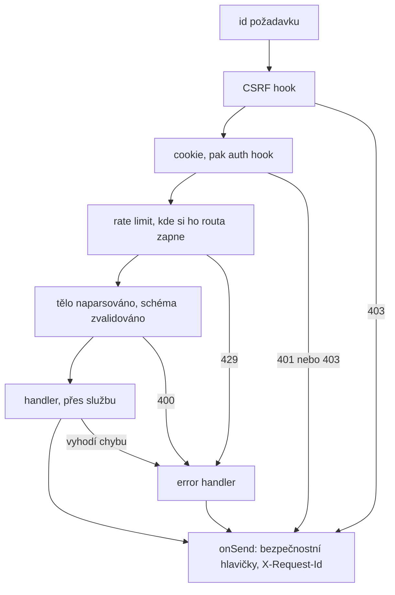

# HTTP

Jak požadavek prochází serverem a jaké odpovědi opouštějí obvyklou cestu.
`src/server.ts` registruje hooky a pořadí, v jakém je registruje, je pořadí, v jakém běží.
Co routy sdílejí, je v `src/http/`: `security.ts` (id požadavku, CSRF, hlavičky), `auth.ts`, `errors.ts`, `etag.ts`, `sendBlob.ts` a `static.ts` (PWA a handler pro nenalezené cesty).

## Jeden požadavek

- Správně formátované příchozí `X-Request-Id` se ponechá, takže id z proxy doprovází požadavek až do logů; jinak je id nové UUID.
- CSRF běží jako první: metoda, která není bezpečná, a jejíž `Sec-Fetch-Site` je přítomná a není `same-origin` ani `none`, dostane `403` dřív, než se přečte cookie.
  Požadavek úplně bez této hlavičky, třeba z curl nebo starého prohlížeče, projde; druhou polovinou obrany je `SameSite=Lax` u cookie.
- Auth hook musí následovat po `@fastify/cookie`, jehož vlastní hook cookie parsuje; čte `config.auth` routy a je jediným kódem, který cookie čte.
- Rate limity jsou hooky na routě, které Fastify spouští až po sdílených hoocích, takže odmítnutý cross-site požadavek se nikdy nezapočítá.
- Handler pro nenalezené cesty prochází stejnými hooky: neznámý `GET` mimo `/api` dostane `index.html` z PWA, cokoli jiného `404`.

## Odpovědi mimo obvyklou cestu

- Stream živých aktualizací si svou odpověď přebírá (hijack), takže k němu nedosáhne `onSend` ani error handler.
  `securityHeaders()` zapisuje sám a při selhání stream ukončí; hlavičku přidanou v `onSend` je nutné přidat i tam.
- Hook, který odpoví předčasně, tělo nikdy nečte; Node ho potom přečte a zahodí, takže se spojení znovu použije.
  Hooky běží dřív, než nahrání zkontroluje `BLOB_LIMIT_BYTES`; předčasná odpověď na tělo nad `BODY_LIMIT_BYTES` spojení zavře, místo aby tělo četla (`sendEarlyProblem`).
- Plugin pro nahrávání nahrazuje parsery těla surovým streamem, takže routa tam, kde to jde, odpoví dřív, než přečte jediný bajt.
  `411` bez `Content-Length` a `413` nad limitem posílají `Connection: close`, protože číst takové tělo je zbytečné; `400`, `404` a `204` opakovaného nahrání ho dočtou a zahodí.
- `BODY_LIMIT_BYTES` omezuje jen parser JSON; nahrání omezuje jeho vlastní kontrola `Content-Length`.

## ETagy

- ETag stránky proudu změn (change feed) je SHA-256 jejího JSON těla, s `Cache-Control: private, no-cache`, takže zařízení pokaždé revaliduje a nezměněná stránka odpoví `304`.
- ETag blobu je jeho id, protože bajty se pod daným id zapisují jen jednou; chybějící soubor odpoví `404` dřív, než se nastaví jakákoli cachovací hlavička (viz [`blobs.md`](blobs.md)).
- `If-None-Match` se porovnává slabě, jak požaduje RFC 9110: `W/` přidané proxy se ignoruje a `*` odpovídá čemukoli.

## Problem details

Každá chyba odchází jako `application/problem+json` podle RFC 9457: `type` je `about:blank`, `title` název stavu, `detail` co se pokazilo, a selhání schématu přidá `errors`, jednu cestu na každý problém.
Služby vyhazují třídy ze `src/shared/errors.ts`, které error handler mapuje na `400`, `401`, `403`, `404`, `409` a `410`; nová třída rozšiřuje některou z nich, jinak odchází jako `500`.
Vlastní 4xx chyby Fastify a pluginů si ponechávají svůj stav, například `413` pro JSON tělo nad limitem a `429` z rate limitu.
Cokoli jiného je `500` bez `detail`, zalogované s id požadavku; klient, který zavěsí uprostřed těla, dostane `400`, zalogované na úrovni info.
Handlery chyby vyhazují; `sendProblem` volají samy jen hooky, handler pro nenalezené cesty a routy pro bloby.
