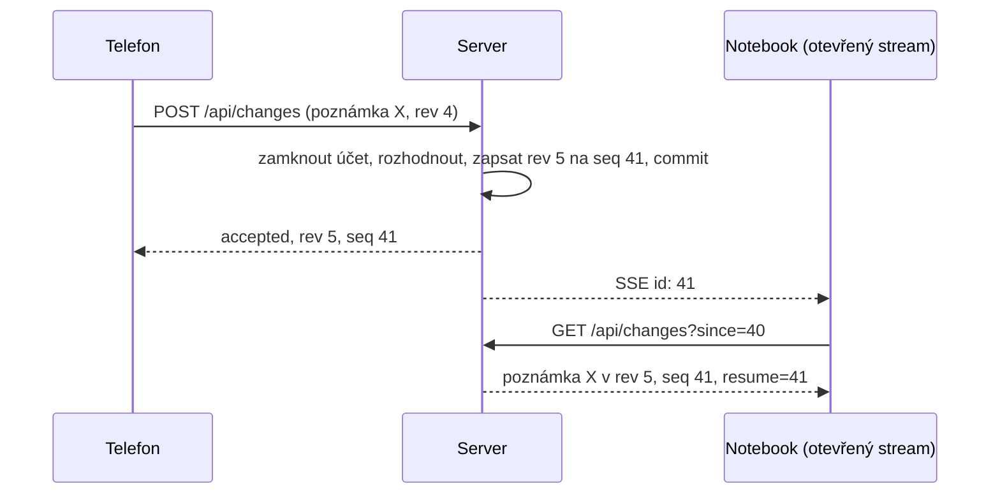

# Synchronizace

Jak se změny ze zařízení dostanou na server a na ostatní zařízení.
Kód je v `src/modules/sync/`: `decide.ts` (pravidla, čistá funkce), `service.ts` (odeslání změn (push) a proud změn (change feed)), `routes.ts` (HTTP a SSE stream), `liveUpdates.ts` (otevřené streamy).
Rozhodnutí za tímto tvarem je ADR 0002 a vyhodnocení synchronizace ve frontendu; produktové pojmy (revize, tombstone (záznam o smazání), konfliktní kopie, dohnání změn, živá aktualizace) jsou ve frontendovém `CONTEXT.md`.

## Dva čítače

- **Revize** (`rev`): pro každý řádek, přiděluje ji server při každém přijatém zápisu; zařízení posílá zpět tu, na které se se serverem naposledy shodlo.
  V duchu jde o `ETag` řádku: push se zastaralým `rev` je konflikt, nikdy tiché přepsání.
- **Pořadové číslo (Sequence)** (`seq`): pro každý účet, posouvá ho každý přijatý zápis; každý synchronizovaný řádek nese pořadové číslo, při kterém byl naposledy přijat.
  Proud změn je podle něj seřazený, kurzor zařízení je jedno takové číslo a nese ho i signál živé aktualizace.
  `prunedSeq` je nejvyšší pořadové číslo tombstonu, který úklid odstranil.

## Odeslání změn (push)

`POST /api/changes` nese jednu dávku: až `MAX_BATCH` řádků napříč `notes`, `tags`, `noteTags` a `tombstones`.
Služba zpracuje celou dávku v jedné transakci a před prvním čtením si vezme zápisový zámek účtu, takže dva pushe do jednoho účtu běží jeden po druhém a nikdy nesdílejí pořadové číslo.
Každý řádek dostane jeden výsledek, v pořadí vstupu; každý přijatý zápis dostane další pořadové číslo.
Po commitu dostane každý další otevřený stream účtu signál s novým pořadovým číslem.

| Zařízení posílá | Server má | Výsledek |
|---|---|---|
| řádek bez `rev` | nic | `accepted`, rev 1 |
| řádek bez `rev` | ten řádek | `conflict`, se serverovým řádkem |
| řádek, `rev` stejné | ten řádek | `accepted`, rev + 1 |
| řádek, `rev` nižší nebo vyšší | ten řádek | `conflict`, se serverovým řádkem |
| jakýkoli řádek | tombstone pro něj | `gone` |
| NoteTag | jeho poznámka nebo štítek chybí nebo má tombstone | `gone` |
| NoteTag, jakékoli `rev` | cokoli jiného | `accepted`; vazba nemá o co být v konfliktu |
| tombstone, `rev` stejné | ten řádek | `accepted`: řádek smazán, tombstone zapsán |
| tombstone, `rev` zastaralé nebo chybí | poznámka nebo štítek | `conflict`, nic se nezapíše; trvalé smazání by zahodilo novější úpravu |
| tombstone | už tombstone | `accepted`, nic se nezapíše; jiné zařízení ho poslalo dřív |
| tombstone pro NoteTag | vazba | `accepted` bez kontroly `rev` |

Řádek bez `rev`, který server už má, je konflikt, protože ho zařízení nikdy neodeslalo, takže serverový řádek je starší nebo patří někomu jinému.
Řádek s `rev`, které server zapomněl (jeho tombstone vypršel), se přijme s rev 1; nic, co kdo napsal, se tak neztratí.

Při `conflict` zařízení převezme serverový řádek a vlastní text si ponechá jako konfliktní kopii, novou poznámku; při `gone` řádek zahodí.
Obojí se děje na zařízení; server jen hlásí výsledek.

## Tombstony

Tombstone říká, že poznámka, štítek nebo vazba byly trvale smazány, aby se smazání dostalo i k zařízením, která byla offline.
Přesunutí do koše je obyčejná úprava `state` a žádný tombstone nezapisuje.
Tabulku malou a proud změn poctivý udržují tři pravidla:

- Trvalé smazání poznámky nebo štítku odstraní jejich vazby, ale nezapíše žádné tombstony pro NoteTag; zařízení si vazby trvale smazaného řádku zahodí sama.
- Opětovné propojení poznámky a štítku odstraní starý tombstone vazby, takže proud změn nikdy neříká obojí.
- Denní úklid (`modules/housekeeping`) odstraňuje tombstony starší než `TOMBSTONE_DAYS` (90) a zvyšuje `prunedSeq` účtu na nejvyšší odstraněné pořadové číslo.

## Proud změn

`GET /api/changes?since=<seq>` vrací řádky účtu zapsané po `since`: až jednu stránku z každého ze čtyř druhů, sloučené podle pořadového čísla a oříznuté na `PAGE_SIZE` (50).
Stránka se čte pod čtecím zámkem účtu, takže push, který mezitím dorazí, ji nemůže rozdělit ani do ní vložit řádek za `seq`, které hlásí.
Plná stránka nese odkaz `next` (`since` = poslední pořadové číslo stránky, `from` = kde stažení změn (pull) začalo); zařízení sleduje `next`, dokud nezmizí, a pak si ponechá `resume` jako kurzor pro příští dohnání změn.
Tělo se posílá s `ETag`, takže nezměněný proud změn odpoví `304`.

Kurzor je odmítnut s `410 Gone` a zařízení se resynchronizuje od 0, když:

- `from` (nebo `since` na první stránce) je větší než 0 a menší než `prunedSeq`: tombstone, který zařízení nikdy nevidělo, byl uklizen, takže by mohlo vzkřísit trvale smazaný řádek;
- `since` je větší než pořadové číslo účtu: kurzor byl vydán předtím, než obnova vrátila databázi zpět.

Posuzuje se `from`, ne aktuální stránka, aby stránkovaná resynchronizace, která v půlce překročí uklizené pořadové číslo, nebyla přerušena.

## Živé aktualizace

`GET /api/changes/stream` je stream Server-Sent Events, jeden na zařízení; nový stream pro stejné zařízení ukončí ten starý.
Každá událost je `id: <seq>` bez payloadu: zařízení na signál odpoví stejným požadavkem na proud změn, jaký by poslalo při pollingu.
Prohlížeč při opětovném připojení pošle `Last-Event-ID`; pokud je pořadové číslo účtu dál, server okamžitě pošle aktuální pořadové číslo.
Zařízení, které push provedlo, nedostane signál o svém vlastním pushi a signály odcházejí až po commitu, takže zařízení, které na signál provede pull, řádky najde.
Streamy žijí v procesu (`LiveUpdates`), a proto server běží jako jedna instance (ADR 0006).

## Co tu záměrně není

Žádný log změn: proud změn se čte z řádků (ADR 0002).
Žádné slučování na úrovni polí a žádné CRDT: konflikt je jedna duplicitní poznámka, kterou člověk vyřeší.
Žádné endpointy pro jednotlivé řádky: dávka a proud změn tvoří celé synchronizační API a bajty příloh putují přes `modules/blobs`.
