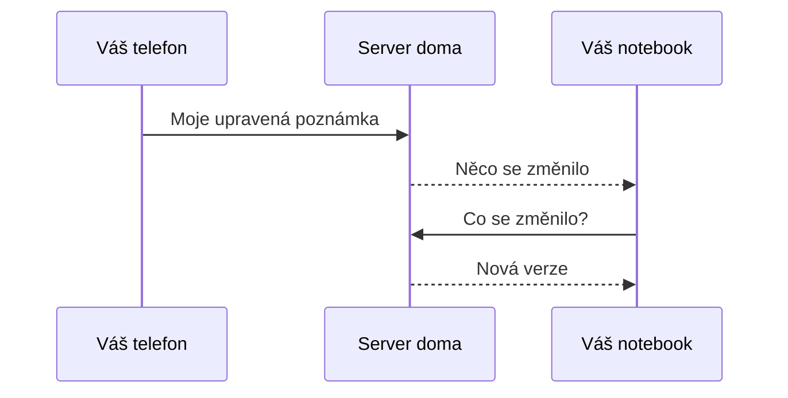

# Jak to funguje

YourNotes je aplikace na poznámky pro telefon, tablet i počítač.
Tento server je ta část, která udržuje vaše poznámky na všech z nich stejné.
Tato stránka bez technických výrazů vysvětluje, co která část dělá a kde jsou vaše poznámky uložené.

## Aplikace na každém zařízení

Poznámka je jedna věc, kterou v aplikaci napíšete: pár slov, seznam úkolů, kresba, fotky nebo nahrávka.
Zařízení je telefon, tablet nebo počítač, který má aplikaci nainstalovanou a je přihlášený k vašemu účtu.

Každé zařízení má vlastní úplnou kopii vašich poznámek.
Proto se aplikace otevře okamžitě a funguje i bez internetu, ve vlaku nebo ve sklepě.
Aplikace funguje i bez serveru, ale pak má každé zařízení jen poznámky, které na něm vznikly.

## Server doma

Server je program, který neustále běží na jednom počítači u vás doma, například na Raspberry Pi, starém notebooku nebo domácím úložišti.
Uchovává hlavní kopii vašich poznámek a každou změnu předává vašim dalším zařízením.
Zároveň poskytuje i samotnou aplikaci.
Aplikaci do každého zařízení instalujete z adresy svého serveru, a díky tomu aplikace ví, se kterým serverem se má synchronizovat.

Kdo se přihlásí jako první, stane se vlastníkem: účtem, který se o server stará, a jediným, který může zvát další.
Každý člen domácnosti má vlastní účet a v aplikaci nikdo nevidí poznámky někoho jiného.

Nové zařízení se připojí pomocí párovacího odkazu: jednorázového odkazu zobrazeného jako čtvercový QR kód, který zařízení přihlásí bez zadávání hesla.
Při prvním spuštění server jeden takový odkaz zobrazí pro vlastníka.
Potom ho pro další zařízení zobrazí zařízení, které už je přihlášené.
Každý párovací odkaz funguje jen jednou a ty, které zobrazí aplikace, po deseti minutách vyprší.

## Co je synchronizace

Synchronizace znamená, že se vaše zařízení prostřednictvím serveru navzájem udržují v aktuálním stavu.
Upravte poznámku na telefonu a za pár sekund bude stejná změna i na notebooku.

1. Telefon pošle upravenou poznámku na server.
2. Server ji uloží a všem ostatním otevřeným zařízením oznámí, že se něco změnilo.
3. Notebook se zeptá, co se změnilo, a zobrazí novou verzi.

Zařízení, které bylo zavřené, si hned po opětovném otevření vyžádá od serveru vše, co zmeškalo.

## Když jste offline

Bez internetu, nebo když jste mimo domov a server je dostupný jen z domova, aplikace funguje jako obvykle.
Nové a upravené poznámky čekají v zařízení.
Nastavení pak v části „Synchronizace a záloha“ ukazuje „Offline. Změny čekají v tomto zařízení.“
Jakmile se zařízení opět spojí se serverem, odešle to, co čekalo, a stáhne, co se mezitím změnilo jinde.

## Dvě změny jedné poznámky

Někdy se jedna poznámka změní na dvou zařízeních dřív, než se kterékoli z nich synchronizuje, například na telefonu bez signálu a na notebooku doma.
To je konflikt a YourNotes nikdy žádnou z verzí nezahodí.

Verze, která dorazila na server jako první, zůstane poznámkou.
Druhá verze se uloží vedle ní jako další poznámka, takzvaná konfliktní kopie.
Její název uvádí zařízení, ze kterého pochází, a datum, například „Groceries (conflict from Pixel 8, 2026-09-28)“, a nese štítek „Conflicts“.
Aplikace oznámí „1 konflikt uložen jako kopie“ a tlačítko „Zobrazit“ otevře tento štítek.

Uvidíte tedy dvě karty vedle sebe.
Přečtěte si obě, přeneste vše, co chcete zachovat, a tu, kterou už nepotřebujete, smažte.

## Co zůstává u vás doma

- Vaše poznámky, štítky, fotky, nahrávky a soubory jsou uložené na vašem počítači a na vašich vlastních zařízeních.
  Nic se neposílá na počítače žádné firmy, pokud se sami nerozhodnete mít soubory v online úložišti nebo poznámky v cizí databázi, jak vysvětluje stránka [PostgreSQL nebo S3 bucket](setup-backends.md).
- Poznámky nejsou uzamčené před samotným serverem: kdo spravuje počítač, může si přečíst každou poznámku na něm.
  V domácnosti jste to obvykle vy.
- Odkaz pro sdílení je odkaz na jednu poznámku jen pro čtení.
  Otevře ho kdokoli, kdo se dostane k serveru, ať je přihlášený, nebo ne.

Kdo se k serveru dostane, záleží na tom, jak ho nastavíte.
Tabulka v části [Vaše data: kdo co vidí](setup.md#11-vase-data-kdo-co-vidi) to ukazuje pro každý způsob.

## Zálohy

Jeden příkaz zkopíruje vše, co server uchovává, do složky: každý účet, poznámku, štítek, fotku i soubor.
Tato kopie je záloha serveru.
Uložte si ji na USB flash disk nebo na jiný počítač.
Když se počítač porouchá, záloha serveru vše vrátí zpět a vaše zařízení se s ním znovu synchronizují.
Část [Zálohování a obnova](setup.md#8-zalohovani-a-obnova) ukazuje, jak zálohu vytvořit a jak ji nechat vytvářet každou noc.

Aplikace umí uložit i vlastní zálohu, v Nastavení pod „Záloha a úložiště“ (po přihlášení „Synchronizace a záloha“), „Exportovat zálohu“.
To je něco jiného: jeden soubor s poznámkami jednoho účtu, vytvořený na jednom zařízení.

## Dále

- [Nastavení serveru doma](setup.md) vás provede celým postupem zhruba za deset minut.
- [Web aplikace](https://soukupj00.github.io/your-notes-fe/cs/) ukazuje samotnou aplikaci a jak ji nainstalovat.
- Na [your-notes-fe.vercel.app](https://your-notes-fe.vercel.app/) si aplikaci můžete nejdřív vyzkoušet v prohlížeči, na jednom zařízení a bez synchronizace.
