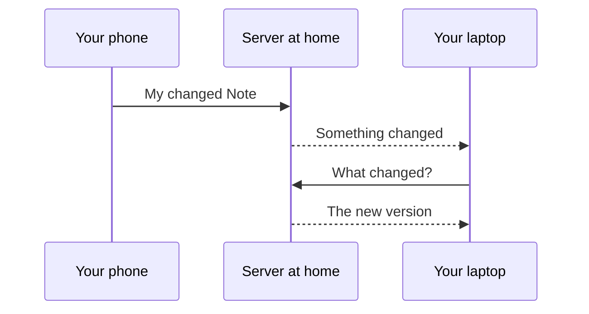

# How it works

YouNotes is a notes app for your phone, tablet and computer.
This server is the part that keeps your notes the same on all of them.
This page explains what each part does and where your notes are kept, without technical words.

## The app on each Device

A Note is one thing you write in the app: a few words, a checklist, a drawing, photos or a recording.
A Device is a phone, tablet or computer that has the app installed and is signed in to your account.

Each Device keeps its own full copy of your Notes.
That is why the app opens at once and keeps working without internet, on a train or in a cellar.
The app also works without a server, but then each Device has only the Notes written on it.

## The server at home

The server is a program that runs all the time on one machine in your home, such as a Raspberry Pi, an old laptop or a home storage box.
It keeps the main copy of your Notes and passes every change on to your other Devices.
It also hands out the app itself.
You install the app on each Device from your server's address, and that is how the app knows which server to sync with.

The first person to sign in becomes the Owner: the account that looks after the server, and the only one that can invite others.
Each person in a household has an account of their own, and nobody sees another person's Notes in the app.

A new Device joins with a Pairing Link: a one-time link, shown as a square QR code, that signs the Device in without typing a password.
When the server first starts, it shows one for the Owner.
After that, a Device that is already signed in shows one for the next Device.
Each Pairing Link works only once, and the ones the app shows run out after ten minutes.

## What syncing is

Syncing means your Devices keep each other up to date through the server.
Change a Note on your phone, and a few seconds later the same change is on your laptop.

1. Your phone sends the changed Note to the server.
2. The server keeps it and tells every other open Device that something changed.
3. Your laptop asks what changed and shows the new version.

A Device that was closed asks the server for everything it missed as soon as it opens again.

## When you are offline

Without internet, or away from home when the server can only be reached at home, the app works as usual.
New and changed Notes wait on the Device.
Settings, under "Storage and sync", then says "Offline. Changes wait on this Device."
As soon as the Device reaches the server again, it sends what waited and gets what changed elsewhere.

## Two changes to one Note

Sometimes one Note is changed on two Devices before either has synced, for example on a phone without signal and on the laptop at home.
That is a conflict, and YouNotes never throws either version away.

The version that reached the server first stays as the Note.
The other version is kept beside it as a second Note, called a Conflicted Copy.
Its title names the Device it came from and the date, such as "Groceries (conflict from Pixel 8, 2026-09-28)", and it carries the label "Conflicts".
The app says "1 conflict kept as a copy", and "Show" opens that label.

So you see two cards side by side.
Read both, copy over anything you want to keep, and delete the one you no longer need.

## What stays in your home

- Your Notes, labels, photos, recordings and files are kept on your machine and on your own Devices.
  Nothing is sent to a company's computers, unless you choose to keep your files in online storage or your Notes in someone else's database, as [PostgreSQL or an S3 bucket](setup-backends.md) explains.
- Notes are not locked away from the server itself: whoever runs the machine can read every Note on it.
  In a household that is usually you.
- A Share Link is a read-only link to one Note.
  It opens for anyone who can reach the server, signed in or not.

Who can reach the server depends on how you set it up.
The table in [Your data: who can see what](setup.md#11-your-data-who-can-see-what) shows it for each way.

## Backups

One command copies everything the server holds into a folder: every account, Note, label, photo and file.
That copy is a Server Backup.
Keep it on a USB stick or another computer.
If the machine breaks, a Server Backup puts everything back, and your Devices sync with it again.
[Back up and restore](setup.md#8-back-up-and-restore) shows how to make one, and how to make one every night.

The app can also save a backup of its own, under Settings, "Backup", "Export a backup".
That is a different thing: one file with the Notes of one account, made on one Device.

## Next

- [Set it up at home](setup.md) walks you through it in about ten minutes.
- [The app's site](https://soukupj00.github.io/your-notes-fe/) shows the app itself and how to install it.
